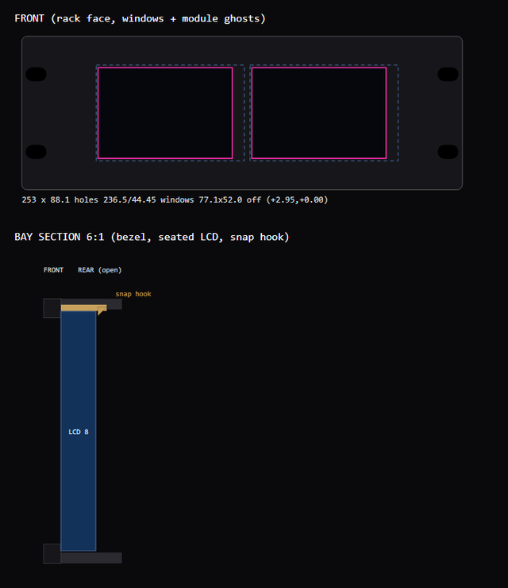
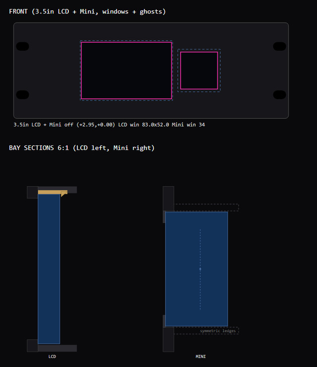
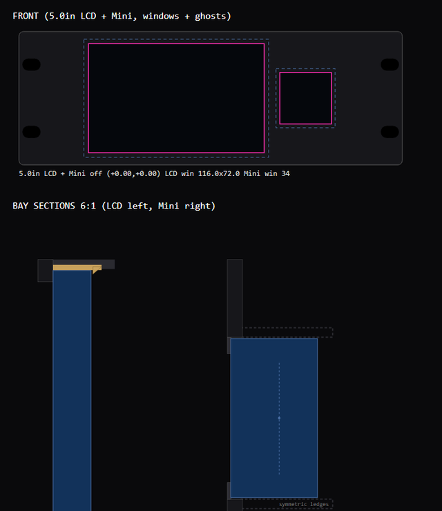
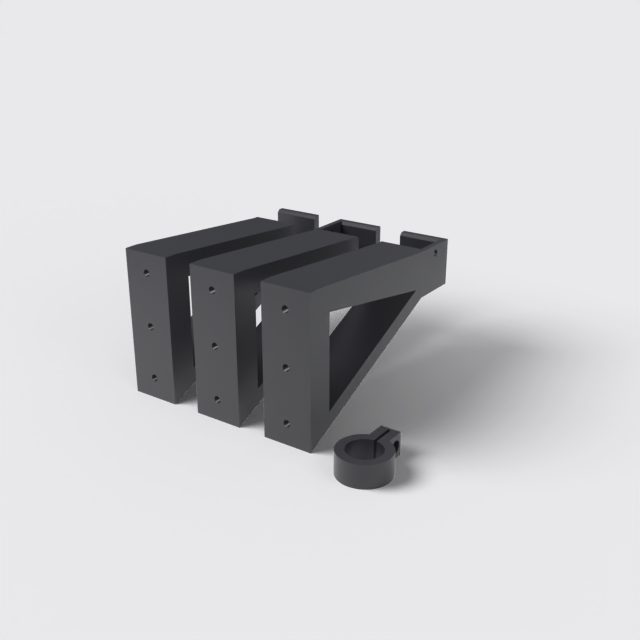
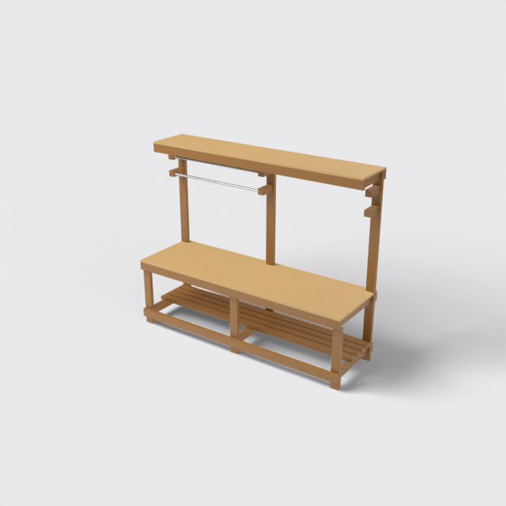

# CAD

[](https://www.python.org)
[](https://www.freecad.org)
[](https://www.blender.org)

> Parametric CAD for laser cutting, 3D printing, and workshop carpentry. Every model is generated from a script, and every script ships its STEP/STL exports plus a preview.

## Models

| Model | Process | Status |
|-------|---------|--------|
| [GTA VI WLED Lightbox](#gta-vi-wled-lightbox) | Laser | Verified |
| [GTA VI Desk Statue](#gta-vi-desk-statue) | Laser | Planned |
| [10in Rack 2U Dual LCD Tray](#10in-rack-2u-dual-lcd-tray) | 3D print | Verified |
| [10in Rack LCD plus JetKVM Plates](#10in-rack-lcd-plus-jetkvm-plates) | 3D print | Verified |
| [Spool Bracket Set](#spool-bracket-set) | 3D print | Verified |
| [8ft Maker Station](#8ft-maker-station) | Lumber | Verified |

Supporting infra: [`src/live/`](./src/live/readme.md) holds one live FreeCAD script per model, named by path mirror, so switching projects never means hunting through folders.

### GTA VI WLED Lightbox


* **What**: 300 x 300 mm square backlit shadow box. Clean faceplate with negative VI windows, relief palm tree layer, full neon adhesion plate, and a two layer foreground lockup traced from the official wordmark art.
* **Process**: Laser cut, single 1/8 in stock (basswood) plus frosted acrylic diffuser and white/black acrylic faces.
* **Status**: Verified. Gapless adhesion stack, one piece text backer with scored placement guides, 4 tree styles in one file.
* **Build**: `freecadcmd "src/GTA VI lightbox/design1-wled-lightbox/lightbox_freecad.py"`
* **Docs**: [`readme.md`](./src/GTA%20VI%20lightbox/design1-wled-lightbox/readme.md)
* **Exports**: [`exports/`](./src/GTA%20VI%20lightbox/design1-wled-lightbox/exports) (13 STEP/STL pairs plus `06_Text_Backer_Plate_laser.svg` with CUT and SCORE layers)
* **Live**: [`src/live/`](./src/live/readme.md) path mirror shim

### GTA VI Desk Statue

* **What**: Non illuminated freestanding layered desk statue, 280 x 220 mm on a slotted pedestal foot. 5 layer relief stack: pedestal, sunset backplate, palm silhouettes, VI contour frame, raised lettering badge.
* **Process**: Laser cut, 3 mm MDF/plywood plus acrylic faces.
* **Status**: Planned. Spec is written, CAD not started, so no screenshot yet.
* **Docs**: [`readme.md`](./src/GTA%20VI%20lightbox/design2-freestanding-statue/readme.md)

### 10in Rack 2U Dual LCD Tray



* **What**: 2U plate for 10 in racks holding 2x 3.5 in SmartCool/AIDA64 LCDs side by side in drop in trays. Bezel offset compensated so both screens sit symmetric about center. Rounded corners, lateral wiggle slots for RackStuds.
* **Process**: 3D print, PETG/ASA.
* **Status**: Verified. Manifold solid, 68.09 cm3.
* **Build**: `freecadcmd "src/10in-rack-2u-lcd/rack_plate_freecad.py"`
* **Docs**: [`readme.md`](./src/10in-rack-2u-lcd/readme.md)
* **Exports**: [`exports/`](./src/10in-rack-2u-lcd/exports) (`Rack_2U_DualLCD_Plate.step/.stl`)
* **Live**: [`src/live/`](./src/live/readme.md) path mirror shim

### 10in Rack LCD plus JetKVM Plates

 

* **What**: 2U plates pairing one LCD (3.5 or 5.0 in) with one JetKVM Mini per endpoint. Mini sits screen forward flush with the plate, body recessed, side button slots usable after a 180 deg plate rotation for left or right hand builds. Blank engravable label field by default.
* **Process**: 3D print, PETG/ASA.
* **Status**: Verified. Both variants manifold. Mini glass/buttons/ports are photo derived, confirm with calipers before a production run.
* **Build**: `freecadcmd "src/10in-rack-lcd-kvm/kvm_plate_freecad.py"` with `RACK_SCREEN=35|50` and optional `RACK_LABEL` text
* **Docs**: [`readme.md`](./src/10in-rack-lcd-kvm/readme.md)
* **Exports**: [`exports/`](./src/10in-rack-lcd-kvm/exports) (`Rack_2U_LCDKVM_35|50_Plate.step/.stl`)
* **Live**: [`src/live/`](./src/live/readme.md) path mirror shim

### Spool Bracket Set



* **What**: Support free cantilever brackets holding 3/4 in EMT conduit spool rods on the maker station. 4 pieces: center (through channel), left end, right end (4 mm stop walls), and an M4 clamped stopper collar.
* **Process**: 3D print on side, zero supports, PETG/PLA+/ASA, 4 to 5 walls, 30 to 40 percent gyroid.
* **Status**: Verified. All 4 solids manifold, rebuilt this session.
* **Build**: `freecadcmd "src/spool-brackets/spool_bracket.py"` (OpenSCAD twin: `spool_bracket.scad`)
* **Docs**: [`readme.md`](./src/spool-brackets/readme.md)
* **Exports**: [`exports/`](./src/spool-brackets/exports) (4 STEP/STL pairs)

### 8ft Maker Station



* **What**: 96 x 30 x 78.75 in multi tier workstation for bed slinger printers plus a soldering bay. Short ways 2x4 bents, zero collision framing, flush capped upper tier, dual tier spool rod cradles above gantry height, bottom slat deck.
* **Process**: Carpentry. 17 boards of 2x4, one sheet of 3/4 in plywood (zero waste rip), construction screws.
* **Status**: Verified. Solid assembly builds plus STEP and per material STLs.
* **Build**: `freecadcmd "src/8ft-maker-station/cad/workbench_freecad.py"` (OpenSCAD twin: `workbench.scad`)
* **Docs**: [`readme.md`](./src/8ft-maker-station/readme.md), [`cut_list.md`](./src/8ft-maker-station/cut_list.md)
* **Exports**: [`cad/exports/`](./src/8ft-maker-station/cad/exports) (`MakerStation.step`, lumber/plywood/rods STLs)

## Repository layout

```
.
├── src/                    # One folder per model, each with readme, build script, exports
│   ├── GTA VI lightbox/    # design1 WLED lightbox (built) + design2 statue (planned)
│   ├── 10in-rack-2u-lcd/   # Dual 3.5 in LCD tray
│   ├── 10in-rack-lcd-kvm/  # LCD plus JetKVM Mini plates, 3.5 and 5.0 variants
│   ├── spool-brackets/     # EMT conduit spool brackets + collar
│   ├── 8ft-maker-station/  # Lumber workbench + cut list
│   └── live/               # Consolidated live FreeCAD scripts (path mirror naming)
├── tests/                  # Bounds and fit checks (python tests/test_tree_bounds.py)
├── project_details/        # Changelog, playbooks, proof assets (mostly local only)
├── docs/                   # Notes and references
└── .skills/                # Agent skills (github workflow, etc.)
```

## Tooling

* FreeCAD 1.1 (`freecadcmd.exe`) builds every `.py` model and regenerates `exports/`.
* Blender 4.5 headless renders catalog thumbnails from STL sets.
* OpenSCAD twins exist for spool brackets and the workbench where noted.
* Python 3.11+ with Pillow/numpy for previews and tests.

## Tests

```powershell
python tests/test_tree_bounds.py
```

Checks all 4 tree styles stay inside the lightbox panel after finger joints. Fit checks for the rack plates run inside their build scripts.

## Contributing

See [AGENTS.md](./.agents/AGENTS.md) for the agent working rules (versioning, changelog, push approval). Issues use the structured forms in `.github/ISSUE_TEMPLATE/`.

## License

See [LICENSE.md](./LICENSE.md) for full license terms.
